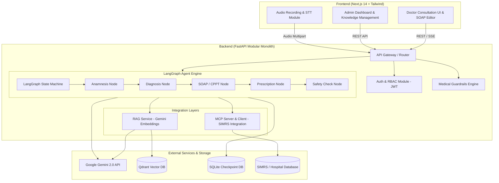

# 🩺 AssistanMedixa (AIMedical)

<div align="center">

[](https://fastapi.tiangolo.com)
[](https://langchain-ai.github.io/langgraph/)
[](https://ai.google.dev/)
[](https://qdrant.tech/)
[](https://nextjs.org/)
[](https://www.typescriptlang.org/)
[](VERSION_NOTES.md)
[](LICENSE)

**Platform Asisten Klinis AI Berbasis Agentic Architecture (FastAPI, LangGraph, Model Context Protocol & Google Gemini)**

[Fitur Utama](#-fitur-utama) •
[Arsitektur Sistem](#-arsitektur-sistem) •
[Struktur Direktori](#-struktur-direktori) •
[Instalasi & Penggunaan](#-instalasi--penggunaan) •
[API Reference](#-api-reference) •
[Version Notes](VERSION_NOTES.md) •
[Disclaimer Medis](#-disclaimer-medis)

</div>

---

## 📖 Ringkasan Proyek

**AssistanMedixa (AIMedical)** adalah platform kecerdasan buatan klinis (*Clinical Decision Support System*) yang dirancang untuk membantu tenaga medis (dokter dan staf klinis) dalam mempercepat alur konsultasi pasien, pembuatan rekam medis CPPT/SOAP, analisis anamnesis terstruktur, hingga pengecekan keselamatan resep obat.

Sistem dibangun dengan arsitektur **Modular Monolith** berkinerja tinggi, mengintegrasikan alur penalaran bertingkat (*multi-step reasoning*) menggunakan **LangGraph**, protokol standar **Model Context Protocol (MCP)** untuk integrasi data SIMRS (Sistem Informasi Manajemen Rumah Sakit), dan **RAG (Retrieval-Augmented Generation)** berbasis Qdrant Vector DB dengan Google Gemini.

---

## ✨ Fitur Utama

- 🧠 **Autonomous Medical Agent (LangGraph)**
  - State machine workflow terstruktur: Anamnesis → Differential Diagnosis → SOAP/CPPT Generation → Medication Recommendation → Red Flags Detection → Safety Guardrail Verification.
  - Alur **Pencarian Vector DB Wajib**: Setiap konsultasi medis umum secara otomatis melewati tahap pencarian semantik vektor Qdrant & Evidence-Based Literature sebelum sintesis respons.
  - Streaming respons real-time (Server-Sent Events) dengan visualisasi langkah penalaran AI.
- 🔌 **Model Context Protocol (MCP) untuk SIMRS**
  - Standardized tool integration untuk membaca riwayat rekam medis (EMR), hasil laboratorium, alergi obat, dan stok farmasi rumah sakit.
- 📚 **Clinical Knowledge Vector RAG Engine (Qdrant) & Dokumen PDF/DOCX**
  - Mesin pencarian semantik panduan praktik klinis (PPK), formularium nasional, diagnosis kerja, dan basis pengetahuan interaksi obat menggunakan **Qdrant Vector DB** dan **Gemini Embeddings**.
  - Dukungan unggah berkas dokumen `.pdf` dan `.docx` dengan ekstraksi teks, pembentukan kata kunci otomatis, dan chunking dokumen ke Vector DB.
- 🏥 **Manajemen Ruang Poli Klinis (Clinic Room Management)**
  - Panel administrasi untuk mengelola ruangan poli (Penyakit Dalam, Jantung, Bedah, Anak, dll.) lengkap dengan kapasitas antrean harian dan status aktif.
  - Integrasi penugasan dokter jaga dan penyaringan daftar pasien aktif berdasarkan poli terpilih.
- 🎙️ **Multimodal Audio Consultation & Temp SOAP Storage**
  - Transkripsi dan ekstraksi poin penting konsultasi verbal dokter-pasien secara instan menggunakan Google Gemini Multimodal.
  - Penyimpanan terstruktur SOAP sementara (`temp_soaps`) pada basis data relasional sebelum dikonfirmasi dan dikirimkan ke SIMRS.
  - Pengayaan otomatis FAQ Medis (Diagnosis, Rekomendasi Obat, Workups/Tindakan) dengan data analisis rekaman audio / SOAP sementara.
- 🚨 **Clinical Red Flags & Emergency Triage**
  - Deteksi dini kondisi gawat darurat dan ambang kegawatdaruratan (*red flags*) secara dinamis dengan klasifikasi keparahan (*Critical / High*).
- 🛡️ **Medical Safety Guardrails & Moderation**
  - Validasi kontraindikasi obat, dosis batas aman terhadap fungsi ginjal (eGFR), dan deteksi alergi pasien.
- 📊 **Panel Administrasi & Audit Trail**
  - Dashboard pemantauan analitik konsultasi, manajemen pengguna (Dokter, Admin, Farmasi), log audit riwayat akses, dan konfigurasi guardrails.
- 🎨 **Modern & Intuitive Clinical UI**
  - Antarmuka responsif berbasis Next.js 14 App Router, Tailwind CSS, Dark/Light theme, panel akordion template Plan, dan modal multi-tab draf RME (Anamnesis, Diagnosis, Resep Obat, CPPT).


---

## 🏛️ Arsitektur Sistem



---

## 📂 Struktur Direktori

```text
AssistanMedixa/
├── backend/
│   ├── app/
│   │   ├── core/                  # Konfigurasi aplikasi, database, dan security
│   │   │   ├── config.py
│   │   │   ├── database.py        # SQLAlchemy models (User, ChatSession, TempSOAP, etc.)
│   │   │   └── security.py
│   │   ├── modules/               # Domain modules (Modular Monolith)
│   │   │   ├── admin/             # Dashboard admin, user management, & analytics
│   │   │   ├── auth/              # JWT authentication & authorization
│   │   │   ├── chat/              # Chat session management & Audio STT
│   │   │   ├── guardrails/        # Safety verification & clinical rules
│   │   │   ├── mcp/               # Model Context Protocol (SIMRS Server/Client)
│   │   │   ├── medical_agent/     # LangGraph Agent Graph, skills, state, & clinical tools
│   │   │   └── rag/               # Vector search, initial knowledge base, & Qdrant service
│   │   │       ├── initial_knowledge.py  # 21 Clinical reference knowledge documents
│   │   │       └── rag_service.py        # Dedicated Qdrant RAG service
│   │   └── main.py                # FastAPI entry point & middleware
│   ├── tests/                     # Automated test suites (40 unit tests)
│   ├── run.sh                     # Backend launch script
│   └── .env.example               # Template environment variable backend
│
├── frontend/
│   ├── app/                       # Next.js 14 App Router
│   │   ├── admin/                 # Admin Dashboard Pages
│   │   ├── doctor/                # Doctor Consultation Workspace
│   │   ├── knowledge/             # Knowledge Management & RAG Explorer
│   │   ├── login/                 # Authentication Page
│   │   ├── layout.tsx             # Root layout & Theme provider
│   │   └── page.tsx               # Landing & Redirects
│   ├── components/                # Reusable UI Components
│   │   ├── admin/                 # Admin charts, audit feeds, user tables, clinic room management
│   │   ├── chat/                  # Chat window, SOAP/CPPT editor, Audio recorder, Draft RME
│   │   ├── common/                # Navbar, modals, metrics card
│   │   └── knowledge/             # Document uploader (PDF/DOCX), table & search explorer
│   ├── hooks/                     # Custom React Hooks
│   ├── services/                  # API Client Services
│   ├── tailwind.config.js         # Tailwind styling configuration
│   └── package.json               # Frontend dependencies & scripts
│
├── .gitignore                     # Git ignore rules
├── requirements.txt               # Python backend dependencies
├── VERSION_NOTES.md               # Catatan rilis dan riwayat versi
└── README.md                      # Dokumentasi teknis proyek
```

---

## 🚀 Instalasi & Penggunaan

### 📋 Prasyarat Sistem
- **Python**: Versi `3.10` atau lebih baru
- **Node.js**: Versi `18.x` atau `20.x` (disertai `npm` atau `pnpm`)
- **Google Gemini API Key**: Dapatkan dari [Google AI Studio](https://aistudio.google.com/)

---

### 1️⃣ Konfigurasi Backend

1. **Buat dan aktifkan Virtual Environment:**
   ```bash
   python3 -m venv .venv
   source .venv/bin/activate   # Di Windows: .venv\Scripts\activate
   ```

2. **Instal dependensi Python:**
   ```bash
   pip install -r requirements.txt
   ```

3. **Konfigurasi Environment Variables:**
   Salin template `.env.example` ke `backend/.env` dan isi kredensial yang sesuai:
   ```bash
   cp backend/.env.example backend/.env
   ```
   *Pastikan mengisi nilai `GEMINI_API_KEY` dan `SECRET_KEY`.*

4. **Jalankan Backend Server:**
   ```bash
   cd backend
   uvicorn app.main:app --host 0.0.0.0 --port 8000 --reload
   ```
   *Swagger API Documentation akan tersedia di `http://localhost:8000/docs`.*

---

### 2️⃣ Konfigurasi Frontend

1. **Pindah ke direktori frontend:**
   ```bash
   cd frontend
   ```

2. **Instal dependensi Node.js:**
   ```bash
   npm install
   # atau menggunakan pnpm
   pnpm install
   ```

3. **Jalankan Frontend Development Server:**
   ```bash
   npm run dev
   ```
   *Aplikasi web akan dapat diakses di `http://localhost:3000`.*

---

## 📡 API Reference Ringkas

| Modul | Method | Endpoint | Deskripsi |
| :--- | :--- | :--- | :--- |
| **Auth** | `POST` | `/api/v1/auth/login` | Otentikasi dan penerbitan JWT Access Token |
| **Auth** | `GET` | `/api/v1/auth/me` | Informasi profil pengguna yang sedang login |
| **Medical Agent** | `POST` | `/api/v1/agent/chat` | Eksekusi penalaran LangGraph Medical Agent |
| **Medical Agent** | `POST` | `/api/v1/agent/chat/stream` | Stream real-time respons & reasoning steps |
| **Poli / Clinic Rooms** | `GET` / `POST` | `/api/v1/admin/clinic-rooms` | CRUD manajemen ruangan poli klinis |
| **Poli / Clinic Rooms** | `POST` | `/api/v1/agent/clinic-rooms/select` | Pemilihan ruangan poli aktif dokter |
| **Chat & STT** | `POST` | `/api/v1/agent/chat/audio` | Transkripsi audio konsultasi dokter & SOAP Temp via Gemini STT |
| **RAG & Knowledge** | `POST` | `/api/v1/rag/search` | Pencarian pedoman klinis & literatur obat |
| **RAG & Knowledge** | `POST` | `/api/v1/rag/upload-file` | Ekstraksi & indexing dokumen pedoman klinis (PDF/DOCX) |
| **MCP SIMRS** | `POST` | `/api/v1/mcp/execute` | Eksekusi tool pemanggilan data SIMRS |
| **Guardrails** | `POST` | `/api/v1/guardrails/verify` | Evaluasi kepatuhan keselamatan klinis |
| **Health** | `GET` | `/api/health` | Healthcheck status backend dan AI service |

---

## 🛡️ Standar Keamanan & Best Practices

- 🔐 **JWT Token Authentication**: Seluruh rute terproteksi diverifikasi dengan JWT token dan RBAC (*Role-Based Access Control*).
- 🛡️ **Medical Verification Layer**: Hasil rekomendasi AI diformulasikan sebagai *Clinical Support System* dengan konfirmasi akhir berada pada dokter penanggung jawab.
- 🗄️ **Persistent State Checkpoints**: Riwayat sesi penalaran LangGraph tersimpan aman dan terisolasi per sesi konsultasi.
- 🔒 **Environment Security**: Tidak ada *hardcoded secrets* maupun kunci API dalam basis kode.

---

## ⚠️ Disclaimer Medis

> **PENTING:**
> **AssistanMedixa** dikembangkan sebagai perangkat lunak pembantu keputusan klinis (*Clinical Decision Support System / CDSS*). Sistem ini **bukan pengganti penilaian klinis langsung, diagnosis resmi, maupun keputusan independen dokter berlisensi**. Semua rekomendasi diagnosis, tindakan medis, dan terapi obat wajib ditinjau dan divalidasi kembali oleh tenaga medis yang berwenang sebelum diterapkan kepada pasien.

---

## 📄 Lisensi

Didistribusikan di bawah Lisensi MIT. Lihat file `LICENSE` untuk informasi lebih lanjut.

---

<div align="center">
  <sub>Dibangun dengan dedikasi untuk memajukan integrasi AI dalam dunia medis & kesehatan.</sub>
</div>
